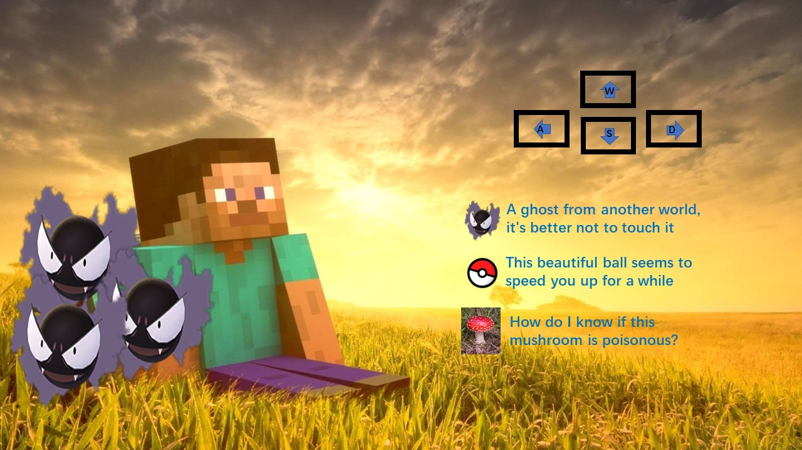

# Cube Man Adventure

A project demo for Interactive Graphics lecture. Created by Weihao Wang (1988339).

The gameplay and original models are for educational purposes only.

## Link to play the game

- [Original project](https://sapienzainteractivegraphicscourse.github.io/final-project-weal_mce/) · [Preserved original](https://wealhour.github.io/An-interactive-browser-game-based-on-WebGL/original/)
- [Remastered game](https://wealhour.github.io/An-interactive-browser-game-based-on-WebGL/remastered/)

## How to play

For the remastered game:

- Select any of the 3 worlds and a difficulty, then click **PLAY**.
- **WASD / arrows** to move, **Space** to dash, **C** to change camera, **Esc / P** to pause. Touch controls and standard gamepads are also supported.
- Walk onto the **blue marked tiles** to collect 3 light fragments, then enter the exit. Fragments are picked up automatically.
- Avoid ghosts and red mushrooms. Golden lights give a speed boost; the blue waystone heals you and saves a checkpoint.

## Credits

- **Weihao Wang** — original author and game concept.
- **ChatGPT / OpenAI Codex** — remaster development and testing.
- **Three.js contributors** — rendering engine. **CodeMan38** — Press Start 2P pixel font.
- [Original model credits and licenses](./CREDITS.md).
