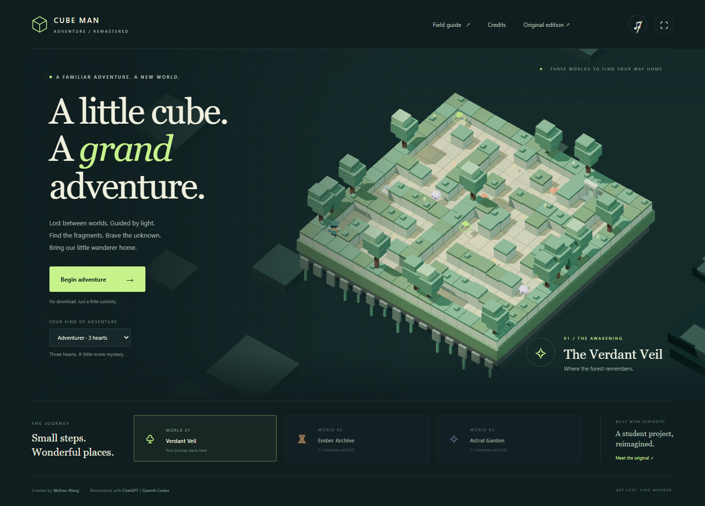

# Cube Man Adventure

**A little cube. A grand adventure.**

An Interactive Graphics student project by **Weihao Wang**, revisited with more experience and a little help from **ChatGPT / OpenAI Codex**. The original is preserved as a memory of where this journey began. The remaster is a new adventure inspired by it.

## Play

1. **[Play the original student project](https://Wealhour.github.io/An-interactive-browser-game-based-on-WebGL/original/)** — the original experience, preserved unchanged.
2. **[Play Cube Man Adventure: Remastered](https://Wealhour.github.io/An-interactive-browser-game-based-on-WebGL/remastered/)** — three worlds, a new visual identity, and a whole new journey.

The [edition selector](https://Wealhour.github.io/An-interactive-browser-game-based-on-WebGL/) brings both chapters together. Both editions are published together by the GitHub Pages workflow in this repository.



## A new journey

Cube Man is lost between worlds. Find three light fragments in each maze to awaken its gate, then step through to continue home.

- **Three distinct worlds:** the Verdant Veil, the Ember Archive, and the Astral Garden.
- **A new voxel world:** floating islands, soft shadows, little wisps, glowing fragments, and an original cube wanderer with a backpack.
- **Movement that feels consistent:** time-based controls, diagonal movement, sliding collision, a short dash, and screen-relative directions.
- **Room to learn:** three difficulty settings, hearts, checkpoint healing, temporary protection after a hit, and quick retries. Collected fragments survive a hit.
- **A readable adventure:** objective tracking, a minimap, optional follow camera, and a field guide.
- **Keyboard, touch, and standard gamepad input.** No account or download required.
- **A reason to return:** unlock worlds, collect optional speed-boosting starlight, and earn up to three stars. Best times and star ratings are stored per world and difficulty in your browser.
- **Comfort settings:** optional synthesized sound, reduced ambient motion, a lighter graphics mode, pause, and fullscreen where supported. Leaving the tab pauses play.

The remaster runs entirely in the browser with a locally bundled Three.js engine. It makes no requests to CDNs, font services, analytics, or accounts. Browser storage is optional; play still works when storage is unavailable. A run in progress is not saved when the page closes.

## Controls

| Action | Keyboard | Touch | Standard gamepad |
| --- | --- | --- | --- |
| Move | WASD or arrow keys | Drag thumbstick | Left stick or D-pad |
| Dash | Space | Dash button | A / bottom face button |
| Pause / resume | Escape or P / Escape | Pause / Keep wandering | Start |
| Camera | C | Follow / Overview button | Use on-screen button |

Get three stars by finishing without a hit and under the target time: **1:40**, **2:20**, and **3:00** respectively. There is no time limit. Golden starlight is optional and boosts movement for three seconds. A dash briefly protects you from hazards. The pale blue waystone heals you and becomes your respawn point.

## The original, kept intact

The complete original project lives in [`original/`](original/), including its README, models, textures, educational declaration, and model license files. No original file content was changed. Its historical loading, controls, and browser limitations are retained too.

[`docs/original-manifest.json`](docs/original-manifest.json) records the SHA-256 hash and size of every original file. Check the archive at any time:

```sh
node scripts/verify-archive.mjs
```

The original README also records its [historical course-hosted address](https://sapienzainteractivegraphicscourse.github.io/final-project-weal_mce/). The archived edition above is hosted alongside the remaster and does not depend on that external address.

## Run locally

Use **Node.js 20 or newer**. No packages need to be installed.

```sh
node scripts/serve.mjs
```

Open [http://127.0.0.1:4173](http://127.0.0.1:4173). Use an HTTP server rather than double-clicking the HTML files, because the games use JavaScript modules and the original uses a physics worker.

```sh
node --test tests/*.test.mjs
node scripts/verify-archive.mjs
node scripts/build-site.mjs
```

The last command produces `_site/` containing only the files needed for hosting. Any ordinary static web host can serve it, including hosts that place the site under a repository subpath.

## Deploy to GitHub Pages

1. Put the **contents of this project folder** at the root of `Wealhour/An-interactive-browser-game-based-on-WebGL`. The root should contain `index.html`, `README.md`, `original/`, `remastered/`, and `.github/`.
2. In the repository, open **Settings → Pages → Build and deployment → Source**, and choose **GitHub Actions**.
3. Push to `main` or `master`, or manually run **Verify and deploy Cube Man Adventure** from the Actions tab. The workflow tests the simulation, verifies the original archive, packages the static site, and deploys both editions together.
4. When the deployment succeeds, use the two Play links at the top of this README.

The deployment workflow follows [GitHub’s static Pages workflow](https://github.com/actions/starter-workflows/blob/main/pages/static.yml). If your default branch has another name, update the workflow’s `branches` list. The project also supports Pages’ branch-based publishing from the repository root if you prefer that setup.

## Credits

**Weihao Wang** — original author, original game concept, and student project.

**ChatGPT / OpenAI Codex** — remaster collaborator: game design, procedural world and character artwork, implementation, interface, accessibility improvements, documentation, and testing. Weihao remains the project creator; this credit acknowledges the AI collaboration requested for the remaster.

**Three.js contributors** — rendering engine (MIT). The remaster reuses the locally bundled r118 engine from the original project. See [`CREDITS.md`](CREDITS.md) for attribution and third-party notes.

The original gameplay and models were provided for educational purposes. Their original declarations and model license files remain in the archive. The remaster uses new procedural artwork and synthesized sounds instead of those character models.
